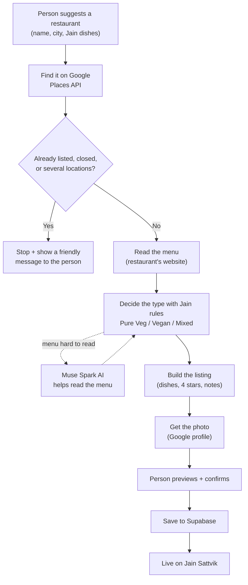

# Jain Restaurants Agent

Sam's first agent - built by hand in Node.js, no framework, to learn how agents work.

It adds ONE restaurant at a time to https://jain-restaurants.netlify.app
following RULES.md exactly.

## How it works (the simple picture)


In plain English:

1. **A person suggests a restaurant** - its name, city, and any Jain dishes they know.
2. **The agent finds it on Google** (the Google Places API) - the exact address, phone, website, and map location.
3. **It checks the directory** (stored in Supabase) - if the restaurant is already listed, closed, or unclear, it stops and shows the person a friendly message instead of guessing.
4. **It reads the menu** on the restaurant's own website.
5. **It decides the type** - Pure Veg, Vegan, or Mixed - using simple Jain rules (for example: meat or fish on the menu means Mixed; "vegan" in the name or Google's label means Vegan). If a menu is a hard-to-read picture or PDF, it asks the **Muse Spark** AI to help read it. That is the only place AI is used.
6. **It builds the listing** - the person's dishes, the standard 4-star rating, and a note about any other locations of the same restaurant in that city.
7. **It gets the photo** from the restaurant's Google profile.
8. **The person sees a preview and confirms** - then the listing is saved and appears live on the Jain Sattvik website.

Safety rails are always on: daily Google usage is capped (if the cap is reached, the message is "Google Quota for Map reached, try later."), secret keys never leave this computer, and anything the agent is unsure about is handed to a human.

The same flow as a diagram (this renders on GitHub):



## Anatomy of this agent

An AI agent = a goal + a loop (observe -> decide -> act) + tools +
guardrails. Here is each part, in this project:

- **Goal:** Add this restaurant to the Jain Sattvik directory,
  correctly, following RULES.md - one restaurant at a time.
- **Senses (observe):** Google Places API (New) lookup - address, phone,
  website, rating, coordinates, place type; Supabase directory search
  (duplicate check); the restaurant's own website (menu text, Slice 3).
- **Brain (decide):** RULES.md encoded as code - lib/classify.js
  (Jain legend / Vegan name-or-type / meat-scan = Mixed / else human),
  the dishes options in lib/dishes.js, lib/chainNotes.js, and the four
  exception stops. The LLM (Muse Spark 1.3 contributor, reasoning
  effort medium, lib/llm.js) is used ONLY when a menu defeats plain
  code scanning (scanned-image menu, awkward PDF).
- **Tools (act):** Places API (lookup, later Place Details + photo),
  Supabase REST (read for duplicates; write at submit time, Slice 5),
  plain HTTP fetch (menu download), Meta Model API (the rare LLM call).
- **Loop (observe -> decide -> act, repeat until done or stopped):**
  look up the place -> if duplicate / closed / multi-location, STOP
  with a customer message; else fetch the menu -> classify -> build
  the listing -> fetch the photo -> (explicit --submit only) write
  to Supabase -> verify the listing is live -> done. Each step's
  result decides what the next step is; it is not a fixed script.
- **Guardrails:** Google quota caps (hard limits in Google Maps
  Platform > Quotas; on 429/RESOURCE_EXHAUSTED the agent stops with
  "Google Quota for Map reached, try later."); API keys live only in
  local .env files, never in code, never committed; Supabase anon key
  only, never service_role; submitting requires an explicit --submit
  (default = dry run); exception stops hand unsettled cases to a
  human instead of guessing.

## Run the scaffold

```
cd ~/Documents/jain-restaurants-agent
node index.js
```

You should see the hello-world message.

## Project layout (so far)

- `index.js` - entry point. For now just `main()` that prints. Later it will call each step in order.
- `RULES.md` - the spec. Every rule from our manual adds, encoded for the agent.
- `package.json` - Node project file: name, start script. No dependencies yet.
- `.env.example` - template for your secrets file. Copy to `.env` in Lesson 1.
- `.gitignore` - keeps `.env` and `node_modules/` out of git.

## Build plan - runnable slices

1. Scaffold + hello-world  [done]
2. Lesson 1: Google Places API key -> .env  [done; Google quota caps set in Maps Platform > Quotas]
3. Slice 1: Lookup (name + city -> address / phone / website / rating / coordinates / place type; multiple matches = print all + STOP; closed / not found get customer GUI messages; quota hit message: "Google Quota for Map reached, try later.")  [done]
4. Slice 2: Duplicate check against the Supabase directory  [done - verified with Planta]
5. Classification rules (lib/classify.js): Jain legend / Vegan-in-name-or-type / meat-scan= Mixed / else human. LLM (Muse Spark 1.3 contributor, reasoning effort MEDIUM) only for rare messy menus.  [rules + LLM connection done; menu fetch pending]
6. Slice 3: Menu fetch + full classification, then listing builder preview (RULES.md applied)  [next]
7. Slice 4: Photo fetch from Places (GetPhotoMedia)
8. Slice 5: Submit + verify (explicit --submit only; default = dry run)

## End state: the public GUI (Phase 2)

People will NOT use this CLI. The end state is an HTML page on the Jain
Sattvik site (a smart "Add Restaurant" page):
  1. Person types a restaurant name + city and clicks search.
  2. The page shows the place the agent found (or the customer messages
     from lib/messages.js: duplicate / closed / pick-a-location / quota).
  3. Person types their Jain dishes, or picks dishes options 1 / 2 / 3
     (radio buttons).
  4. Page shows the agent's classification + listing preview; person confirms.
  5. Agent submits to Supabase; success message shown.
Architecture note: a browser page can NEVER hold the secret keys (Google,
LLM), so this same lib/ code will run behind a small server function -
Netlify Functions is the natural fit (the site is already on Netlify) or a
Supabase Edge Function. The CLI we are building now is the agent's brain;
the GUI is just a face on it later. Build the brain first, face second.
