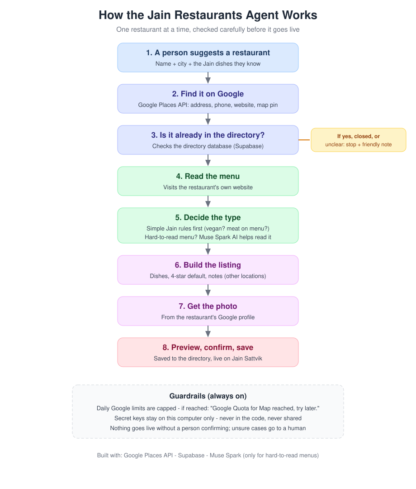
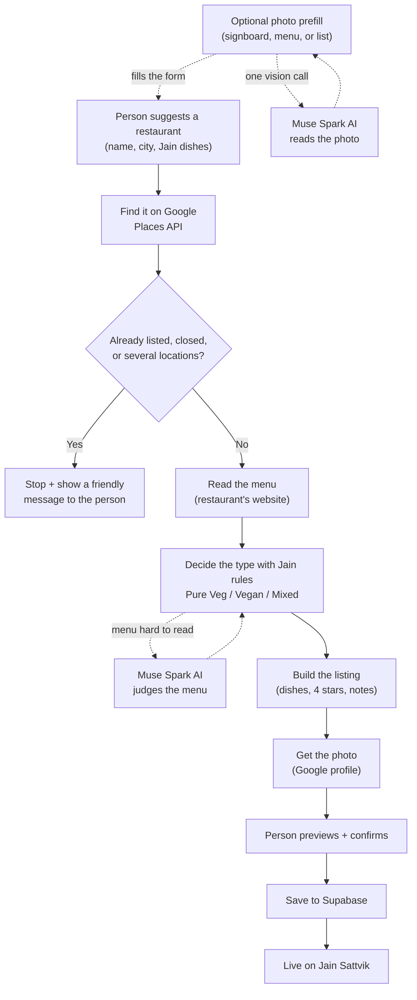

# Jain Restaurants Agent

Sam's first agent - built by hand in Node.js, no framework, to learn how agents work.

It adds ONE restaurant at a time to https://jain-restaurants.netlify.app
following RULES.md exactly.

## How it works (the simple picture)



*This end-to-end flow IS the agent's loop for one restaurant: each box is observe or act, each arrow is a decision made from what the previous step found. The loop runs once per restaurant and ends at "live" - or earlier, at a stop (duplicate, closed, unclear), which is also a decision. It runs again from the top for the next restaurant.*

In plain English:

1. **Optional photo prefill** [PRE-STEP] - before typing anything, the person can upload a photo (a signboard, a menu, or a list of restaurants). One **Muse Spark** vision call reads it and fills in the name, city, and dishes - or offers a picker when the photo lists several. Details: "Photo prefill" and "Photo list picker" below.
2. **A person suggests a restaurant** - its name, city, and any Jain dishes they know (typed, picked from the photo, or both).
3. **The agent finds it on Google** [OBSERVE] (the Google Places API) - the exact address, phone, website, and map location.
4. **It checks the directory** [OBSERVE] (stored in Supabase) - if the restaurant is already listed, closed, or unclear, it stops and shows the person a friendly message instead of guessing.
5. **It reads the menu** [OBSERVE] on the restaurant's own website.
6. **It decides the type** [REASON] - Pure Veg, Vegan, or Mixed - using simple Jain rules (for example: meat or fish on the menu means Mixed; "vegan" in the name or Google's label means Vegan). If a menu is a hard-to-read picture or PDF, a second, separate **Muse Spark** call judges it - that and the photo read are the only two places AI is used.
7. **It builds the listing** [ACT] - the person's dishes, the standard 4-star rating, and a note about any other locations of the same restaurant in that city.
8. **It gets the photo** [OBSERVE] from the restaurant's Google profile.
9. **The person sees a preview and confirms** [EVALUATE, then ACT] - the agent checks its own work first (a fail blocks the submit); then the listing is saved and appears live on the Jain Sattvik website (the live row is compared with the preview).

The tags in brackets point to the stage each step belongs to in "The loop, as it now stands" below.

Safety rails are always on: daily Google usage is capped (if the cap is reached, the message is "Google Quota for Map reached, try later."), secret keys never leave this computer, and anything the agent is unsure about is handed to a human.

The same flow as a diagram (this renders on GitHub):



## Anatomy of this agent

An AI agent = a goal + a loop (observe -> decide -> act) + tools +
guardrails. Here is each part, in this project:

- **Goal:** Add this restaurant to the Jain Sattvik directory,
  correctly, following RULES.md - one restaurant at a time.
- **Senses (observe):** Google Places API (New) lookup - address, phone,
  website, rating, coordinates, place type; Supabase directory search
  (duplicate check); the restaurant's own website (menu text, Slice 3).
- **Brain (decide):** RULES.md encoded as code - lib/classify.js
  (Jain legend / Vegan name-or-type / meat-scan = Mixed / else human),
  the dishes options in lib/dishes.js, lib/chainNotes.js, and the four
  exception stops. The LLM (Muse Spark 1.3 contributor, reasoning
  effort medium, lib/llm.js) is used ONLY when a menu defeats plain
  code scanning (scanned-image menu, awkward PDF), plus the photo
  prefill (lib/photoRead.js, below).
- **Tools (act):** Places API (lookup, later Place Details + photo),
  Supabase REST (read for duplicates; write at submit time, Slice 5),
  plain HTTP fetch (menu download), Meta Model API (two LLM calls:
  the photo read and the rare menu-judge call).
- **Loop (observe -> decide -> act, repeat until done or stopped):**
  look up the place -> if duplicate / closed / multi-location, STOP
  with a customer message; else fetch the menu -> classify -> build
  the listing -> fetch the photo -> (explicit --submit only) write
  to Supabase -> verify the listing is live -> done. Each step's
  result decides what the next step is; it is not a fixed script.
- **Guardrails:** Google quota caps (hard limits in Google Maps
  Platform > Quotas; on 429/RESOURCE_EXHAUSTED the agent stops with
  "Google Quota for Map reached, try later."); API keys live only in
  local .env files, never in code, never committed; Supabase anon key
  only, never service_role; submitting requires an explicit --submit
  (default = dry run); exception stops hand unsettled cases to a
  human instead of guessing.

## Run the scaffold

```
cd ~/Documents/jain-restaurants-agent
node index.js
```

You should see the hello-world message.

## Project layout (so far)

- `index.js` - entry point. For now just `main()` that prints. Later it will call each step in order.
- `RULES.md` - the spec. Every rule from our manual adds, encoded for the agent.
- `package.json` - Node project file: name, start script. No dependencies yet.
- `.env.example` - template for your secrets file. Copy to `.env` in Lesson 1.
- `.gitignore` - keeps `.env` and `node_modules/` out of git.

## Build plan - runnable slices

1. Scaffold + hello-world  [done]
2. Lesson 1: Google Places API key -> .env  [done; Google quota caps set in Maps Platform > Quotas]
3. Slice 1: Lookup (name + city -> address / phone / website / rating / coordinates / place type; multiple matches = print all + STOP; closed / not found get customer GUI messages; quota hit message: "Google Quota for Map reached, try later.")  [done]
4. Slice 2: Duplicate check against the Supabase directory  [done - verified with Planta]
5. Classification rules (lib/classify.js): Jain legend / Vegan-in-name-or-type / meat-scan= Mixed / else human. LLM (Muse Spark 1.3 contributor, reasoning effort MEDIUM) only for rare messy menus.  [rules + LLM connection done; menu fetch pending]
6. Slice 3: Menu fetch + full classification, then listing builder preview (RULES.md applied)  [next]
7. Slice 4: Photo fetch from Places (GetPhotoMedia)
8. Slice 5: Submit + verify (explicit --submit only; default = dry run)
9. Slice 6: Batch mode - an OUTER loop around the one-restaurant loop:
   feed a list, the agent processes #1 fully, then #2, then #3...
   A stop on one restaurant (duplicate / closed / unclear) is recorded
   in a per-restaurant result log and does NOT kill the batch - the
   loop moves to the next one and prints a summary at the end.
   (Watch the daily Google quota cap: batch size is bounded by it.)

## End state: the public GUI (Phase 2)

People will NOT use this CLI. The end state is an HTML page on the Jain
Sattvik site (a smart "Add Restaurant" page):
  1. Person types a restaurant name + city and clicks search.
  2. The page shows the place the agent found (or the customer messages
     from lib/messages.js: duplicate / closed / pick-a-location / quota).
  3. Person types their Jain dishes, or picks dishes options 1 / 2 / 3
     (radio buttons).
  4. Page shows the agent's classification + listing preview; person confirms.
  5. Agent submits to Supabase; success message shown.
Architecture note: a browser page can NEVER hold the secret keys (Google,
LLM), so this same lib/ code will run behind a small server function -
Netlify Functions is the natural fit (the site is already on Netlify) or a
Supabase Edge Function. The CLI we are building now is the agent's brain;
the GUI is just a face on it later. Build the brain first, face second.

## Phase 2 architecture: ONE brain, THREE faces (Sam, 2026-10-23)

There is also an iOS app (jain-restaurants-mobile, Expo/React Native) -
and it already reads the SAME Supabase project as the website. So the
integration is NOT "build the agent twice":

  lib/runAgent.js  <-- the brain. Input JSON -> result JSON.
        ^                    The result shape IS the API contract:
        |                    { outcome, message, places[], listing,
        |                      classification, photo }
        |
  ONE hosted endpoint (Netlify Function wrapping runAgent;
  keys live in the function's env, never in any client)
        ^                    ^
        |                    |
  Website "Add" page      iOS app "Add" screen
  (HTML/JS fetch)         (Expo fetch - same JavaScript world)

Rules that follow from this:
- Customer-facing texts come from the endpoint (lib/messages.js), so
  website and app show identical wording - single source of truth.
- Both clients render the same states natively: form (real dishes
  first, preset options below), location picker, preview card,
  exception banners, submit confirm.
- Website button label (Sam, 2026-10-25): "Add Restaurant (AI Agent)" -
  distinct from the site's existing manual Add Restaurant form, so
  visitors can tell the agent flow apart.
- Photos: the endpoint uploads to the Supabase bucket and returns
  photo_url; clients only display the URL.
- PUBLIC submissions insert DIRECTLY, exactly like Sam's own adds
  today (Sam's decision 2026-10-23: a review queue is overkill -
  submission volume will be low, and as admin he can edit any
  listing afterward if needed). No queue in the plan.
- Local server.js stays the dev harness for both faces (simulator /
  browser on the same Mac); it is never exposed publicly.

Order of work when Phase 2 starts: (1) freeze the runAgent contract,
(2) Netlify Function + website page, (3) iOS screen on the same
endpoint, (4) international country/region handling in the listing builder.

## Integration requirements (Sam, 2026-10-23 night - deep-think item for tomorrow)

- THEME: every new page/dialog must match the existing Jain Sattvik
site's theme and style (colors, fonts, card look). Sam will judge
it side by side with the live site. The local web.html is a plain
functional draft - NOT the design.
- FORM FACTOR: DECIDED (Sam, 2026-10-23 night, updated same night)
- a DIALOG (modal), but built as a SEPARATE component from the
page: its own file(s)/styles/logic, loaded by the site, so the
page and the dialog can never break each other - the separateness
is in the code, the dialog is in the experience. It must MATCH
THE SITE AS IT LOOKS NOW (theme source: the site's own index.html
+ styles.css in ~/Documents/jain-restaurants). Redesign underway
2026-10-23 night so Sam can test the real look.
- DO NOT BREAK THE EXISTING SITE: the integration must be isolated
(its own component / route / styles) so a bug in the add-flow can
never take down browsing/search. The brain already lives behind
one endpoint; the face must be equally separable - removable by
deleting one link/button if anything misbehaves.
- TESTING: more testing of the local page first (tonight's build)
before any integration work. Test menu lives in this chat
(2026-10-23): duplicate, multi-pick, not-found, vegan-by-name,
preview-only, missing-dishes block, real submit.

## Phase 2 details (Sam's questions, 2026-10-23 evening)

Admin:
- NO review queue (Sam: overkill - see above). The site's existing
admin login stays what it already is: Sam's way to EDIT a listing
after the fact if a public submission needs fixing. Nothing new
to build for moderation in Phase 2.

When name + city are not enough (ambiguity):
- Layer 1 (already ours): the endpoint returns FULL addresses, so
any multi-match shows the user a picker list - the list itself
reveals "two cities / two countries" cases. A human always picks.
- Layer 2: one OPTIONAL form field, "State / Country (if needed)" -
type-ahead from Google. Search is biased by it (Places locationBias);
blank = no bias. Never a required field.
- Layer 3: if ONE result comes back but its country differs from
the directory country the search implied, show its full address
with a confirm banner ("We found this in Toronto, Canada - is
this the one?") instead of silently previewing.
- iOS bonus: the app can offer "near me" - device location biases
the search automatically.
- Other countries are NORMAL, not an exception (Sam clarified
2026-10-23: people WILL add restaurants in other countries; the
picker list works across countries too). The "USA" rule was only
a naming standard - US entries say "USA", never "United States"
(that split Planta into a phantom 10th country). Country comes
from the place's own address.
KNOWN CODE ITEM for Phase 2 (plan only, not yet built):
lib/buildListing.js currently hardcodes country "USA" and maps
US state abbreviations to full names. International support =
derive country from the address's last segment (mapping
"United States" -> "USA"), keep the region/state segment as
given for non-US addresses, near_city = the searched city.
Phone already stores international format.

## The loop, as it now stands (2026-10-24)

The diagram Sam shared (2026-10-24) names the loop:

  Observe -> Reason -> Act -> Evaluate -> Repeat as needed

Our loop now matches it, step for step, for one restaurant:

  OBSERVE  - Places lookup (address, phone, website, photo, types),
             duplicate check against the directory, menu fetch.
  REASON   - Classification: code rules first (Jain legend / vegan in
             name-or-type / meat scan = Mixed / vegetarian signals =
             Pure Veg). When the code rules give up (UNKNOWN) but menu
             text exists, the LLM judges the messy menu (lib/llmJudge.js)
             - bounded: only vegetarian/both/vegan/null, must cite
             evidence, any failure falls back to UNKNOWN.
  ACT      - Build the listing, upload the photo, insert, read-back.
  EVALUATE - NEW (lib/evaluate.js), two halves:
               (a) PRE-SUBMIT: independent checks on the finished
                   listing (dishes present, classification evidence
                   real, menu URL is a real page and menu text looks
                   like a menu, no hours in notes). A fail BLOCKS the
                   submit - the agent stops its own bad work. Warnings
                   (no photo, medium confidence) ride along.
               (b) POST-SUBMIT: the live row is compared field-by-
                   field with the preview. A mismatch is reported as
                   'submitted-mismatch', not hidden behind "VERIFIED".
             The evaluator deliberately does NOT reuse the code it
             checks (it re-checks the menu URL and menu text itself),
             so a bug in the fetcher cannot also blind the evaluator.
             That is the lesson of Forno Rosso, built into the loop.
  REPEAT   - Bounded, never infinite: the menu fetcher already tries
             multiple candidate pages; a failed evaluation on one
             restaurant does not kill a batch (Slice 6); and every
             evaluation failure is written to runs.log.jsonl, feeding
             the reviewed learning layer (INCIDENTS.md + regression
             tests) instead of silently recurring.

## What "the agent decides" means here - and what it does not

The agent DOES decide, within guardrails: which menu page to trust,
what the classification is, whether its own work passes evaluation,
whether to retry, and when to stop and hand the decision to a human.
It does NOT decide to change its own rules, to invent data, or to
publish work that failed evaluation. That boundary is deliberate:
judgment inside the loop, rule changes outside it (human-reviewed,
versioned, tested). The agent gets smarter run by run through
evaluation findings + the learning layer - not by rewriting itself.

## Sam's standing direction (2026-10-24)
"Agent should decide; we don't need to think about all the rules."
Applied as: Muse (and the agent) should decide sensible defaults and
only bring Sam genuine forks - a real ambiguity, a safety question, a
trade-off with no safe default. Micro-rules are no longer routed to
Sam for a ruling; they are decided, logged, and tested.

## The three things every agent needs - and how ours does each (2026-10-24)

An agent can only decide well if it is handed three things. This is
the whole design of this project, stated plainly:

### 1. A GOAL - "add only places a Jain diner can actually eat at."
- Set once, by Sam. It never changes run to run.
- It is why the agent refuses work that does not serve it: a place
  with no Jain evidence, a duplicate, a permanently closed outlet.
  Refusing is not failure - it is the goal doing its job.
- The goal is written in RULES.md and in the agent's purpose: every
  step below serves it, and no step may override it.

### 2. TOOLS - Google lookup, the directory, the menu.
- Places API (New): find the place, its address, phone, website,
  photo, coordinates, and type.
- Supabase directory: the duplicate check and the final insert.
- The restaurant's own website: the menu, fetched as plain text.
- The agent never invents what a tool did not return: a missing phone
  or website stays blank, never guessed. Tools observe; they do not
  decide.

### 3. A WAY TO JUDGE GOOD FROM BAD - this is the loop's job.
- The standard is set once, by Sam: dishes are required; never invent
  a phone number or website; a listing with no evidence is not good
  enough; Pure Veg needs menu-text evidence; no opening hours in notes.
- The LOOP applies that standard on every restaurant, by itself:
  OBSERVE (lookup, duplicate check, menu) -> REASON (classify; the
  LLM judges only the messy-menu cases the code rules give up on) ->
  ACT (build, upload photo, insert) -> EVALUATE (lib/evaluate.js) ->
  REPEAT as needed (bounded retries; a failure on one restaurant
  never kills a batch).
- EVALUATE has two halves:
  (a) PRE-SUBMIT - independent checks on the finished listing. A fail
      BLOCKS the submit even when Submit was pressed; the agent stops
      its own bad work and says why. Warnings (no photo, medium
      confidence) ride along visibly. The checks deliberately do NOT
      reuse the code they check, so a bug in the fetcher cannot also
      blind the evaluator (the Forno Rosso lesson).
  (b) POST-SUBMIT - the live row is compared field-by-field with the
      preview. A mismatch is reported, not hidden behind "VERIFIED".
- What the loop does NOT do: invent the standard, change its own
  rules, or publish work that failed evaluation. Judgment inside the
  loop; rule changes outside it (human-reviewed, versioned, tested
  - see INCIDENTS.md).

## How to read any future change to this project
Ask which of the three it touches: a new GOAL (Sam decides), a new
TOOL (a new sense), or a better way to JUDGE (a new check). Most
improvements from here are the third kind - and that is the point:
the loop gets better at judging, so fewer new scenarios need new
rules, and fewer decisions ever reach a human.

## Photo prefill (optional pre-step, 2026-10-25)

Before typing anything, the dialog offers "Upload photo" at the far
right of the Restaurant Details line. A photo of a signboard,
storefront, or menu is downscaled in the browser and sent to POST
/api/read-photo (server.js locally, the Netlify Function hosted),
where lib/photoRead.js makes ONE more Muse Spark Contributor call -
the same model, key, and endpoint as the menu judge - and returns
{ name, city, dishes }. Each new upload clears the name, city, and
typed dishes first (Sam, 2026-10-25), so a previous photo's values
never linger; the read then fills only fields that are still empty
(typing during the read is respected). If even one field was
extracted, it fills silently with no
message (Sam's rule, 2026-10-25); only when the photo yields nothing
at all does it show "Nothing to extract from photo. Please enter the
restaurant name, city, and recommended Jain dishes." It never
submits: the user still reviews, looks up, previews, and submits.
Same honesty rules as the judge: JSON-only, temperature 0,
null/empty on any failure, never invents. Cost is one
user-initiated vision call per upload on a downscaled photo. The
photo is a public scene (signboard/menu), sent to Meta under the
contributor tier like menu text. On the hosted endpoint the 10s
function limit can bite a vision call, as with the menu judge;
locally there is no such limit.

## Photo list picker (2026-10-25)

The same upload also handles a photo that LISTS several restaurants
(a screenshot of a list, for example). The one vision call returns
them all as restaurants[] - each with its name, its dishes if shown,
and its full description text as its note (Sam, 2026-10-25: the note
used to keep only the Jain fragment and dropped the rest - 123V Browns
lost "Vegan sushi concept"). The dialog shows them as
a picker instead of guessing which one was meant. Tapping one fills
the name, the shared city if the photo gave one (otherwise a typed
city stays), its dishes, and its Jain note into the notes field -
and resets the dish choice, so nothing leaks from a previous
restaurant. The normal Look Up -> Preview -> Submit flow then runs
for that ONE restaurant, and picking consumes the session: there is
no loop in the dialog, by design (Sam, 2026-10-25). Bulk adds from a
list photo happen later, once the endpoint is public: Sam hands the
list image to Muse, and Muse calls the endpoint once per restaurant,
one at a time.
